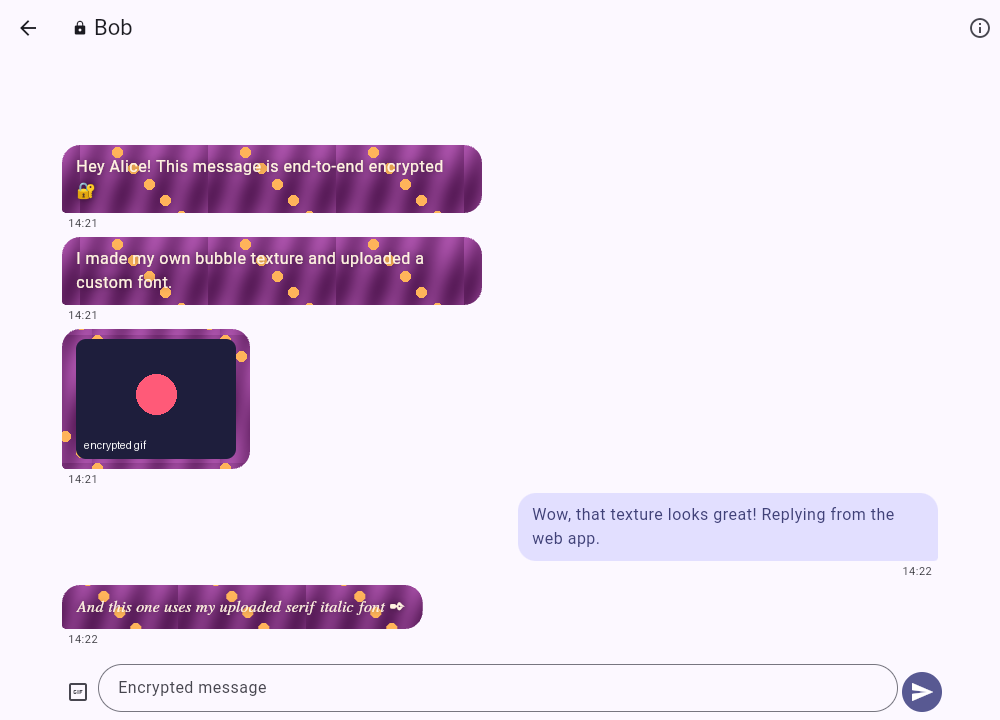
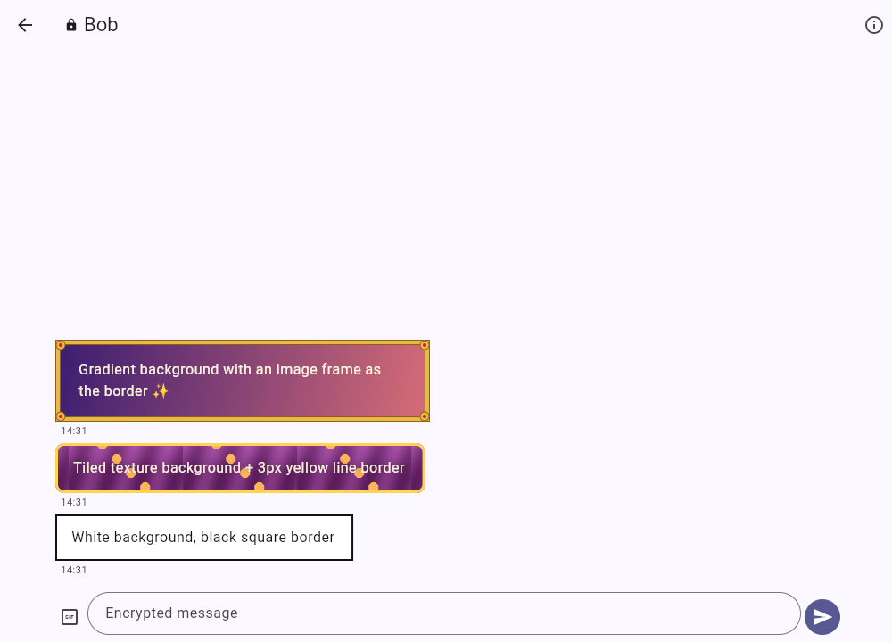
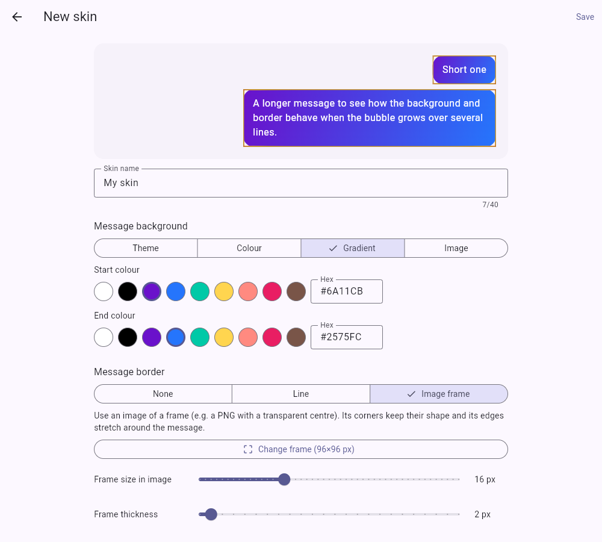
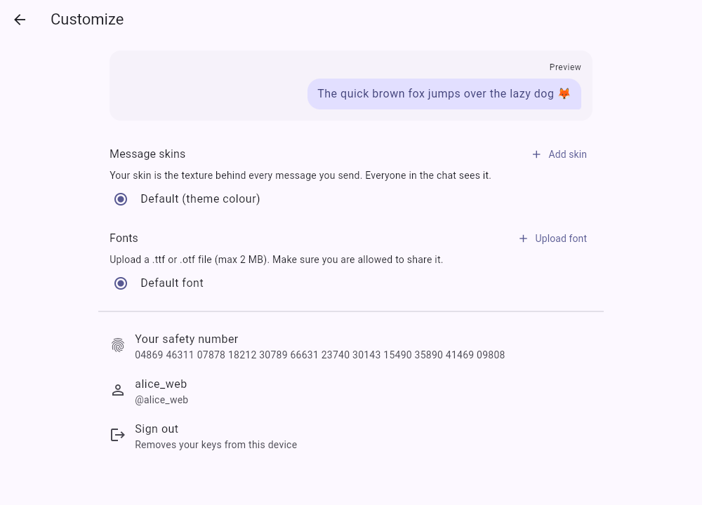
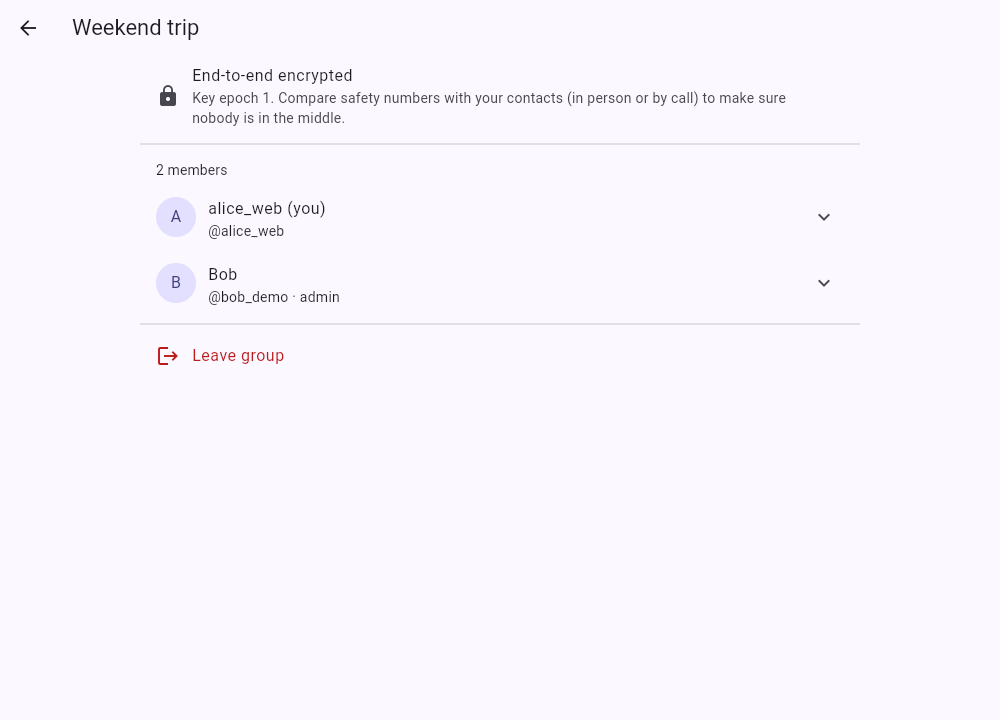

# CChat

An end-to-end encrypted chat app for **Web, Android, Linux and Windows**, built with
Flutter and Supabase.



## Features

- **Direct chats and group chats.** Admins can add and remove group members, and anyone can leave a group.
- **End-to-end encryption.** X25519 + AES-256-GCM, with Ed25519 signatures on every message. Each
  membership change rotates the group key. A passphrase-protected key backup lets you sign in on
  several devices. See [docs/E2EE.md](docs/E2EE.md).
- **Text and GIFs.** You can search GIFs (GIPHY, proxied through an Edge Function) or upload your own,
  which are encrypted before upload.
- **Message skins:** design how your messages look to everyone:
  - **Background:** theme colour, solid colour, gradient, or an image (cover, tile, stretch or 9-slice)
  - **Border:** none, a line (colour and width), or an **image frame**: a decorative frame image
    whose corners keep their shape while the edges stretch around the message
  - Corner radius and text colour, with a live preview in the editor
- **Custom fonts.** Upload a `.ttf` or `.otf` file and your messages are shown in it for everyone.
- **Live updates** through Supabase Realtime, plus unread counts and safety numbers for verifying contacts.

| Skins: background + border | Skin editor |
|---|---|
|  |  |

| Customize | Group info |
|---|---|
|  |  |

## Repository layout

```
app/                    Flutter app (web, android, linux, windows)
  lib/crypto/e2ee.dart  all cryptography
  lib/services/         session/keys, chat, skins & fonts, GIF search
  lib/features/         screens
  test/                 crypto unit tests + integration tests against local Supabase
supabase/
  migrations/           schema, RLS policies, RPCs, storage buckets
  functions/gif-search/ Edge Function (GIF search proxy)
docs/E2EE.md            encryption design and limitations
TECHSTACK.md            tech stack decisions
```

## Getting started

Requirements: [Flutter](https://docs.flutter.dev/get-started/install) (stable, 3.50 or newer),
the [Supabase CLI](https://supabase.com/docs/guides/local-development/cli/getting-started)
and Docker for the local backend.

### 1. Backend

**Local:**

```bash
supabase start          # applies supabase/migrations automatically
supabase status         # shows API URL and publishable key
```

**Hosted project:**

```bash
supabase link --project-ref <your-project-ref>
supabase db push
supabase secrets set GIPHY_API_KEY=<key from developers.giphy.com>
supabase functions deploy gif-search
```

Under *Authentication → URL configuration*, add your web app's URL. Turn email
confirmations on or off as you like (the app handles both).

### 2. App

```bash
cd app
cp env.example.json env.json      # fill in SUPABASE_URL and SUPABASE_PUBLISHABLE_KEY
flutter pub get
flutter run -d chrome  --dart-define-from-file=env.json   # web
flutter run -d linux   --dart-define-from-file=env.json   # linux
flutter run -d windows --dart-define-from-file=env.json   # windows
flutter run -d <device> --dart-define-from-file=env.json  # android
```

Only ever put the **publishable** (anon) key in the app, never the secret or service-role key.

Platform notes:

- **Linux:** needs `libgtk-3-dev libsecret-1-dev` to build, and a Secret Service
  (GNOME Keyring or KWallet) at runtime to store the keys.
- **Android:** the `INTERNET` permission is already declared.
- **Web:** `flutter build web --dart-define-from-file=env.json`, then host
  `build/web` on any static host (Cloudflare Pages, Netlify, Vercel, GitHub Pages…).

## Tests

```bash
cd app
flutter test                                   # crypto unit tests
# integration tests against the local stack (RLS, key rotation, realtime, storage):
SUPABASE_URL=http://127.0.0.1:54321 SUPABASE_PUBLISHABLE_KEY=<from supabase status> flutter test
```

CI (`.github/workflows/ci.yml`) starts a local Supabase, lints the database, runs all
tests, and builds web, Linux, Android (APK) and Windows. Set the repository secrets
`SUPABASE_URL` and `SUPABASE_PUBLISHABLE_KEY` to build against your hosted project.
